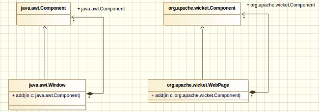

////
   Licensed to the Apache Software Foundation (ASF) under one or more
   contributor license agreements.  See the NOTICE file distributed with
   this work for additional information regarding copyright ownership.
   The ASF licenses this file to You under the Apache License, Version 2.0
   (the "License"); you may not use this file except in compliance with
   the License.  You may obtain a copy of the License at

        http://www.apache.org/licenses/LICENSE-2.0

   Unless required by applicable law or agreed to in writing, software
   distributed under the License is distributed on an "AS IS" BASIS,
   WITHOUT WARRANTIES OR CONDITIONS OF ANY KIND, either express or implied.
   See the License for the specific language governing permissions and
   limitations under the License.
////

Wicket allows us to design our web pages in terms of components and containers, just like AWT does with desktop windows.
Both frameworks share the same component-based architecture: in AWT we have a _Windows_ instance which represents the physical windows containing GUI components (like text fields, radio buttons, drawing areas, etc...), in Wicket we have a _WebPage_ instance which represents the physical web page containing HTML components (pictures, buttons, forms, etc... ) .

In both frameworks we find a base class for GUI components called _Component_. Wicket pages can be composed (and usually are) by many components, just like AWT windows are composed by Swing/AWT components. Both frameworks promote the reuse of presentation code and GUI elements building custom components. Even if Wicket already comes with a rich set of ready-to-use components, building custom components is a common practice when working with this framework. We'll learn more about custom components in the next chapters.

